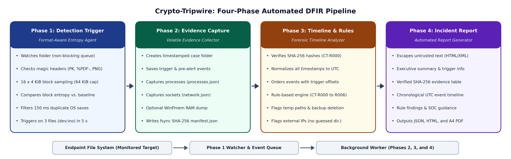

# Crypto-Tripwire: Entropy-Based Ransomware Detection for Automated Volatile Evidence Capture and Incident Response

**Author:** Mahesh Ravi (`AM.SC.P2CSN25010`)  
**Program:** M.Tech Cybersecurity Systems and Networks (Semester 3 Minor Project)  
**Institution:** Center for Cybersecurity Systems and Networks, Amrita Vishwa Vidyapeetham, Amritapuri Campus  
**Project Guide:** Sreelakshmi R Syam  

## 1. What the Project Does

**Crypto-Tripwire** is an automated four-phase Digital Forensics and Incident Response (DFIR) pipeline for Windows and Linux endpoints. It monitors target folders for high-entropy file encryption bursts and automatically captures volatile forensic evidence before the offending process exits:

1. **Phase 1 - Format-Aware Header & Entropy Detection Trigger (`crypto_tripwire/entropy.py`, `crypto_tripwire/detector.py`):**
   - Watches target directories for file creation, modification, move, and delete events via a non-blocking queue.
   - Checks the file's leading magic header signature (`PK` `0x504B0304` for `.zip`/`.docx`/`.xlsx`, `%PDF-` for `.pdf`, `PNG` `0x89504E47` for `.png`, `7z`, `Rar!`), samples up to `16 x 4 KiB` (`64 KiB` max) blocks, compares block entropy against each file's prior baseline (`BaselineStore`), and filters duplicate OS save notifications (`150 ms`).
   - Suppresses normal `.zip` and `.pdf` saves while catching both full encryption and partial header encryption. When `3` distinct files spike within `5.0 s`, Phase 1 triggers Phase 2.
2. **Phase 2 - Automated Volatile Evidence Capture (`crypto_tripwire/capture.py`):**
   - Creates a unique timestamped case folder (`cases_output/case_<UTC>_<seq>_<uid>/`).
   - Saves the trigger event (`trigger.json`), recent file events (`pre_alert_events.json`), running processes (`processes.json`), active network sockets (`network.json`), and optional physical RAM acquisition metadata (`memory_acquisition.json`).
   - Writes all evidence files atomically (`fsync` + `os.replace`) and records their SHA-256 hashes in `manifest.json`.
3. **Phase 3 - Rule-Based Evidence Extraction and Timeline Reconstruction (`crypto_tripwire/timeline.py`):**
   - Independently recalculates SHA-256 hashes (`verify_case_manifest()` -> `verification.json`) to detect tampering before parsing.
   - Normalizes all timestamps to UTC (`timeline.json`) and evaluates deterministic forensic rules (`CT-R000` to `CT-R006` -> `findings.json`).
4. **Phase 4 - Automated Incident Report Generation (`crypto_tripwire/reporting.py`):**
   - Sanitizes untrusted filenames and command lines (`html.escape` / `xml_escape`) and compiles three reports in the case directory: `incident_report.json`, `incident_report.html`, and an A4 printable `incident_report.pdf`.

## 2. Architectural Block Diagram & Code Structure



| File / Module | Phase / Role | Key Classes & Functions | Inputs | Outputs |
| :--- | :--- | :--- | :--- | :--- |
| `main.py` / `crypto_tripwire/cli.py` | CLI Entry Point | `main()`, `cmd_monitor()`, `cmd_verify()`, `cmd_analyze()` | CLI flags or `--config <path.json>` | Live monitoring, manifest verification, or case analysis |
| `crypto_tripwire/config.py` | Configuration | `AppConfig`, `DetectorSettings`, `CaptureSettings`, `ResourceLimits` | `configs/default_config.json` | Validated config object + canonical SHA-256 digest |
| `crypto_tripwire/models.py` | Data Models | `EntropyMeasurement`, `TriggerRecord`, `TimelineEvent`, `FindingRecord` | Raw measurements and artifact metadata | JSON-serializable dataclasses |
| `crypto_tripwire/entropy.py` | Phase 1 (Entropy & Magic Headers) | `compute_shannon_entropy()`, `detect_magic_header_format()`, `BaselineStore`, `EntropyAnalyzer.measure_file()` | File path on disk | `EntropyMeasurement` (magic header status, `16 x 4 KiB` block entropies, baseline delta) |
| `crypto_tripwire/detector.py` | Phase 1 (Watcher & Burst Trigger) | `AsyncFilesystemMonitor`, `BurstDetectionEngine.process_notification()` | OS filesystem notifications (`watchdog` or `os.stat` poller) | Filters `150 ms` duplicates, tracks `3 files / 5.0 s`, emits `TriggerRecord` |
| `crypto_tripwire/capture.py` | Phase 2 (Volatile Capture & SHA-256) | `EvidenceCaptureCoordinator.capture_case()`, `ProcessProvider`, `NetworkProvider`, `verify_case_manifest()` | `TriggerRecord` and pre-alert buffer | `trigger.json`, `processes.json`, `network.json`, `manifest.json`, `verification.json` |
| `crypto_tripwire/timeline.py` | Phase 3 (Timeline & Rule Engine) | `TimelineReconstructor.reconstruct()`, `parse_iso_to_utc()`, `_evaluate_rules()` | Case folder + `VerificationReport` | `timeline.json` and `findings.json` (`CT-R000` to `CT-R006`) |
| `crypto_tripwire/reporting.py` | Phase 4 (Report Generator) | `IncidentReportGenerator.generate_case_reports()`, `_render_html()`, `_render_pdf()` | Case JSON artifacts | `incident_report.json`, `incident_report.html`, `incident_report.pdf` |
| `crypto_tripwire/pipeline.py` | Pipeline Coordinator | `CryptoTripwirePipeline.start()`, `execute_incident_workflow()`, `analyze_existing_case_directory()` | `AppConfig` + Phase 1 trigger callback | Runs Phase 1 on watcher thread and Phases 2-4 on worker thread |
| `scripts/extract_case_metrics.py` | Case Metrics Summary | `extract_case_metrics()` | Case directory or `cases_output/` | Prints timing, integrity, and finding summaries |

## 3. Requirements

- **Operating System:** Windows 10/11 or Linux.
- **Python Version:** Python `3.10`, `3.11`, or `3.12`.
- **Dependencies (`requirements.txt`):** `reportlab`, `watchdog`, `psutil`.

## 4. Quick Start on Windows Host

```powershell
python -m venv .venv
Set-ExecutionPolicy -Scope Process -ExecutionPolicy Bypass
.\.venv\Scripts\Activate.ps1
pip install -r requirements.txt
```

### Run the 16 Automated Tests
```powershell
python -m unittest discover -s tests -v
```

### Start Live Folder Monitoring
```powershell
python -m crypto_tripwire monitor --config configs/default_config.json
```

### Verify Integrity or Re-Analyze an Existing Case
```powershell
python -m crypto_tripwire verify-case historical_reference/evidence_output
python -m crypto_tripwire analyze-case historical_reference/evidence_output --output-dir ./demo_case_out
python scripts/extract_case_metrics.py historical_reference/evidence_output
```
