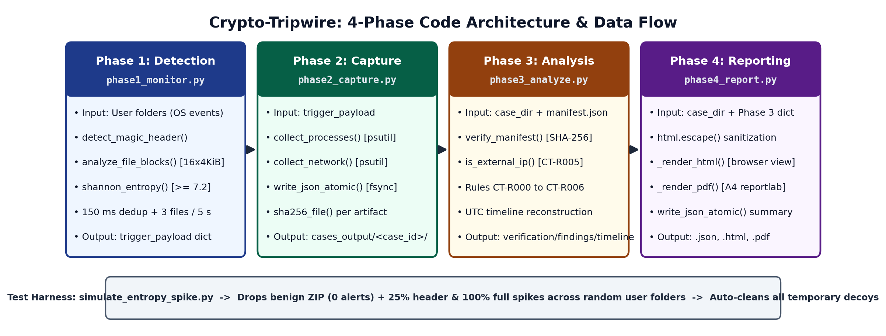

# Crypto-Tripwire: Entropy-Based Ransomware Detection & Automated 4-Phase DFIR Pipeline

**Author:** Mahesh Ravi (`AM.SC.P2CSN25010`)  
**Program:** M.Tech Cybersecurity Systems and Networks  
**Institution:** Center for Cybersecurity Systems and Networks, Amrita Vishwa Vidyapeetham, Amritapuri Campus  
**Project Guide:** Sreelakshmi R Syam  

## 1. What the Project Does

**Crypto-Tripwire** is a lightweight, four-phase Digital Forensics and Incident Response (DFIR) pipeline written in Python. It continuously monitors user directories (`Desktop`, `Documents`, `Downloads`, `Pictures`, `Videos`, `Music`) for rapid high-entropy file encryption bursts and automatically executes forensic evidence capture, SHA-256 verification, timeline analysis, and incident report generation without human intervention:

1. **Phase 1 (`phase1_monitor.py`) - Format-Aware Entropy Detection:** Inspects file magic headers (`PK` `0x504B0304`, `%PDF-`, `PNG`, `7z`, `Rar!`), samples up to `16 x 4 KiB` (`64 KiB` cap) blocks, filters duplicate OS save events (`150 ms`), suppresses benign compressed files (`0` false alarms), and automatically triggers Phase 2 when `3` distinct files spike past `7.2 bits/byte` within `5.0 s`.
2. **Phase 2 (`phase2_capture.py`) - Automated Volatile Evidence Capture:** Creates a timestamped folder inside `cases_output/`, captures active running processes (`processes.json`) and live network sockets (`network.json`), writes all files atomically (`fsync`), and records their SHA-256 digests in `manifest.json`.
3. **Phase 3 (`phase3_analyze.py`) - Chain-of-Custody Verification & Rule Engine:** Recomputes every artifact's SHA-256 hash (`verification.json`), normalizes event timestamps into a chronological UTC timeline (`timeline.json`), and evaluates deterministic forensic rules `CT-R000` to `CT-R006` (`findings.json`).
4. **Phase 4 (`phase4_report.py`) - Automated Incident Reporting:** Sanitizes untrusted filenames/command lines (`html.escape`) and compiles three analyst-ready reports: `incident_report.json`, `incident_report.html`, and A4 `incident_report.pdf`.

## 2. Why the Project Is Useful

- **Beats the Volatile Evidence Window:** Ransomware often finishes encrypting files and exits within seconds, before an analyst can manually collect process or socket evidence. Crypto-Tripwire triggers capture automatically in milliseconds.
- **Eliminates Common False Positives & Catches Partial Encryption:** Naive entropy scripts raise false alarms on normal `.zip`/`.pdf` saves and miss modern intermittent ransomware that encrypts only file headers. Checking magic headers alongside `4 KiB` block entropy solves both problems while capping reads at `64 KiB` per file for speed.
- **Tamper-Evident & Analyst-Ready:** Every artifact is hashed with SHA-256 before analysis and compiled directly into browser-viewable HTML and printable A4 PDF reports.

## 3. Architectural Block Diagram & Module Summary



| File | Phase | Key Functions | Inputs | Outputs |
| :--- | :--- | :--- | :--- | :--- |
| `phase1_monitor.py` | Phase 1 | `detect_magic_header()`, `analyze_file_blocks()`, `shannon_entropy()`, `main()` | Monitored user folders (live OS events) | `trigger_payload` dict (automatically calls Phases 2-4) |
| `phase2_capture.py` | Phase 2 | `collect_processes()`, `collect_network()`, `write_json_atomic()`, `run_phase2_capture()` | `trigger_payload`, `output_root` | `cases_output/<case_id>/` (`trigger.json`, `processes.json`, `network.json`, `manifest.json`) |
| `phase3_analyze.py` | Phase 3 | `verify_manifest()`, `is_external_ip()`, `run_phase3_analyze()` | `case_dir` + `manifest.json` | `verification.json`, `timeline.json`, `findings.json` (`CT-R000` to `CT-R006`) |
| `phase4_report.py` | Phase 4 | `_render_html()`, `_render_pdf()`, `run_phase4_report()` | `case_dir` + Phase 3 results | `incident_report.json`, `incident_report.html`, `incident_report.pdf` |
| `simulate_entropy_spike.py` | Test Harness | `get_candidate_folders()`, `main()` | Random user folders | Safe benign ZIP + 25% header & 100% full spikes (auto-erases all decoys) |

## 4. Requirements

- **OS:** Windows 10/11 or Linux
- **Python:** Python `3.10` or higher
- **Libraries (`requirements.txt`):**
  - `watchdog>=4.0,<7.0` (native OS file watcher; includes built-in `os.stat` poller fallback)
  - `psutil>=5.9,<8.0` (live process and network socket enumeration)
  - `reportlab>=4.0,<5.0` (A4 PDF incident report generation)

## 5. Quick Start (Run on Default Settings in < 30 Seconds)

```powershell
git clone https://github.com/AmritaCSN/Crypto-Tripwire.git
cd Crypto-Tripwire
python -m venv .venv
Set-ExecutionPolicy -Scope Process -ExecutionPolicy Bypass
.\.venv\Scripts\Activate.ps1
pip install -r requirements.txt
```

Open **two terminals** in VS Code:
- **Terminal 1 (Start Live Monitoring Across All User Folders):**
  ```powershell
  python phase1_monitor.py --open-report
  ```
- **Terminal 2 (Run Safe Multi-Folder Entropy-Spike Simulation):**
  ```powershell
  python simulate_entropy_spike.py
  ```

Terminal 1 suppresses the benign `.zip` (`0` alerts), catches both the 25% header spike and 100% full-file spike across random user folders, automatically runs Phases 2, 3, and 4, and opens `incident_report.html`. Terminal 2 automatically deletes all temporary decoy files afterward.

## 6. Advanced Usage - Parameters, Arguments & Tuning Examples

### A. Command-Line Arguments

1. **`phase1_monitor.py`:**
   - `--watch <dir1> <dir2> ...`: Override the default user folders and watch specific directories only.
     ```powershell
     python phase1_monitor.py --watch C:\Users\mahes\Documents C:\Users\mahes\Desktop
     ```
   - `--output <path>`: Save captured forensic case folders to a custom directory (default: `./cases_output`).
     ```powershell
     python phase1_monitor.py --output D:\ForensicCases --open-report
     ```
   - `--open-report`: Automatically opens the generated `incident_report.html` in the default web browser after Phase 4 finishes.

2. **`simulate_entropy_spike.py`:**
   - `--dirs <dir1> <dir2> ...`: Restrict temporary decoy drops to specific folder(s) instead of all standard user folders.
     ```powershell
     python simulate_entropy_spike.py --dirs C:\Users\mahes\Documents
     ```
   - `--cleanup-delay <seconds>`: Seconds to wait after the burst before automatically erasing temporary decoy files (default: `3.0`).
     ```powershell
     python simulate_entropy_spike.py --cleanup-delay 5.0
     ```

### B. Adjustable Detection Constants (`phase1_monitor.py`)

| Constant | Default | How to Adjust & Example |
| :--- | :--- | :--- |
| `ENTROPY_THRESHOLD` | `7.2` | Shannon entropy cutoff in `bits/byte` (`[0, 8]`). Raise to `7.5` for stricter alerts or lower to `7.0` for higher sensitivity. |
| `COUNT_THRESHOLD` | `3` | Distinct high-entropy files needed to trigger Phase 2. Raise to `5` on busy shared workstations. |
| `TIME_WINDOW_SECONDS` | `5.0` | Sliding burst window in seconds. Increase to `10.0` to catch slower throttling ransomware. |
| `COOLDOWN_SECONDS` | `3.0` | Seconds before Phase 1 re-arms after an alert. Increase to `10.0` to space out repeated captures. |
| `CHUNK_SIZE` / `MAX_CHUNKS` | `4096` / `16` | Block sampling cap (`16 x 4 KiB = 64 KiB` max read per file). Increase `MAX_CHUNKS` to `32` for deeper sampling on multi-megabyte files. |
